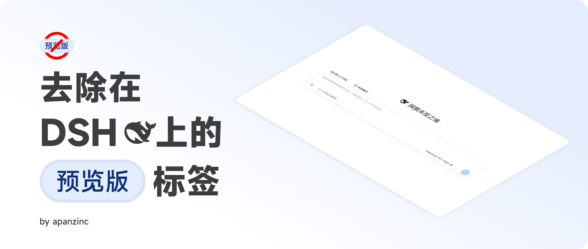

# 去除预览版标签



[](https://www.npmjs.com/package/dsh-no-preview-badge) 

去除在 DSH（DeepSeek Harness）上的预览版标签 —— 隐藏主页 Logo 旁的“预览版”小标。

一个极简的 DSH 客户端插件：零依赖，核心只有一条 CSS 规则，卸载即恢复原样。

## 原理

插件加载时向页面注入一条样式，卸载时自动移除：

```css
[class*="previewBadge"] {
  display: none !important;
}
```

按“类名包含 previewBadge”匹配，不绑定样式哈希前缀（如 `WOwLGG_`），因此 DSH 升级后大概率仍然有效。

## 安装（个人使用）

```bash
npm install dsh-no-preview-badge
```

也可以从源码安装：

1. 克隆本仓库；
2. 按你平时安装本地 DSH 插件的方式装入本目录（DSH 会读取 `package.json` 的 `dsh` 字段，并合并 `cordis.patch.yml`）；
3. 刷新页面，小标消失。卸载插件即可恢复原样。

## 文件结构

| 文件 | 作用 |
| --- | --- |
| `client.js` | 客户端脚本：注入 CSS |
| `index.js` | 宿主侧入口（空实现） |
| `cordis.patch.yml` | DSH 配置补丁：注册插件 |
| `locale/` | 插件名称与描述（en / zh） |
| `icon.svg` | 插件图标 |

`README.md`、`LICENSE`、`banner.png` 为仓库文件，不随插件打包。

## 说明

- 本项目仅供个人使用，欢迎按需修改。
- 功能与其他项目有所重合；如有更合适的同类项目，欢迎使用其他项目。

## 许可

[MIT](LICENSE) © 2026 apanzinc
